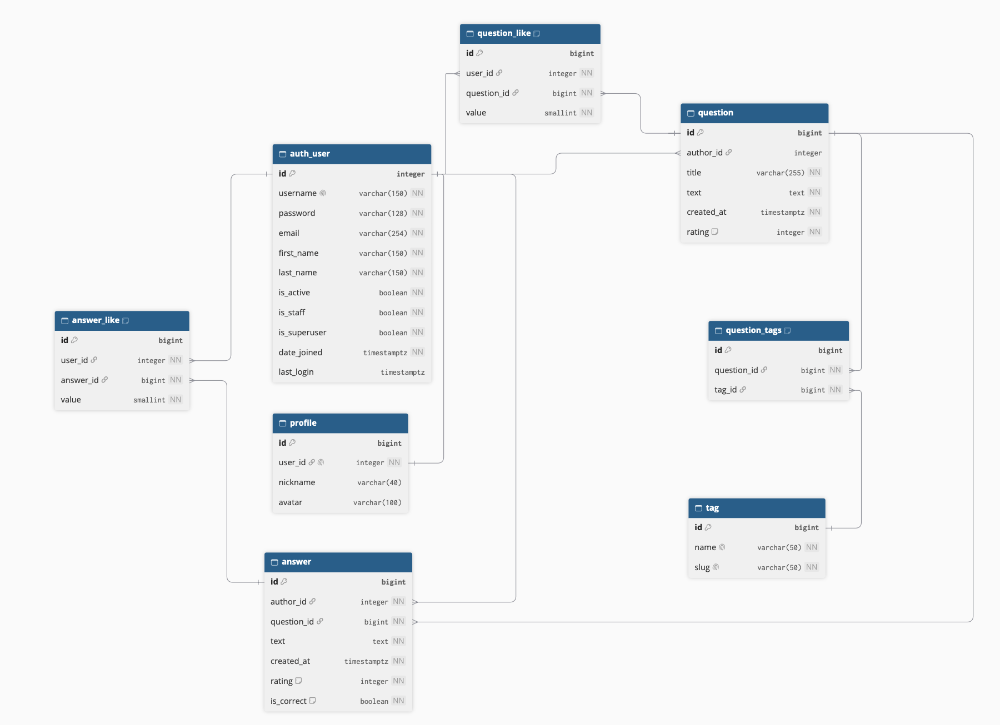

# 2026-VK-EDU-Web-11-Malov-T

**404** - сервис вопросов и ответов

## ДЗ 1 - статическая вёрстка

- Список новых вопросов - `public/index.html`
- Вопрос с ответами - `public/question.html`
- Задать вопрос - `public/ask.html`
- Вход - `public/login.html`
- Регистрация - `public/signup.html`
- Настройки профиля - `public/profile.html`
- Базовый шаблон - `public/base.html`

## Как открыть вёрстку

Откройте `public/index.html` в браузере двойным кликом: установка зависимостей не нужна.

Через Live Server: откройте папку проекта в VS Code, установите расширение **Live Server**, нажмите правой кнопкой на `public/index.html` и выберите **Open with Live Server**.

Альтернатива - из корня проекта выполнить `python3 -m http.server 8000 --directory public` и открыть http://localhost:8000/.

## ДЗ 2 и ДЗ 3 - Django и PostgreSQL

Сайт работает с PostgreSQL 16. Типовые выборки находятся в QuerySet/Manager,
вопросы и ответы пагинируются; повторные голоса ограничены на уровне БД.
Формы входа, регистрации, профиля, создания вопроса и ответа пока демонстрируют
вёрстку: это read-only версия. Редактирование данных доступно в админке.

| Адрес | Страница |
|---|---|
| `/` | Новые вопросы |
| `/hot/` | Лучшие вопросы |
| `/tag/<slug>/` | Вопросы по существующему тегу |
| `/question/<id>/` | Вопрос с ответами |
| `/ask/`, `/login/`, `/signup/`, `/profile/` | Формы |
| `/admin/` | Административная панель |

### Подготовка настроек

Нужны Python 3.12 и запущенный Docker Desktop с Docker Compose.

```bash
cp -n .env.local.example .env.local
cp -n .env.docker.example .env.docker
```

### Локальный запуск

Из корня репозитория:

```bash
python3.12 -m venv .venv
source .venv/bin/activate
python -m pip install -r requirements.txt
docker compose --env-file .env.docker up -d --wait db
set -a
source ./.env.local
set +a
python manage.py migrate
python manage.py runserver
```

### Запуск через Docker Compose

После подготовки `.env.docker`:

```bash
docker compose --env-file .env.docker up --build
```

### Администратор

Локально, после загрузки окружения:

```bash
python manage.py createsuperuser
```

Войдите на `/admin/`

### Наполнение БД

Локально:

```bash
python manage.py fill_db 2
python manage.py fill_db 10000
```

Каждый запуск добавляет новую порцию, не удаляя прежние записи

### Схема БД


